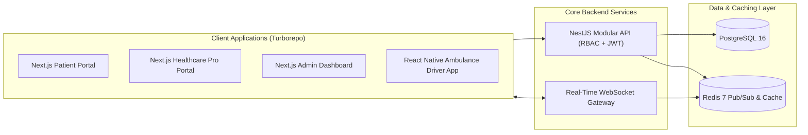
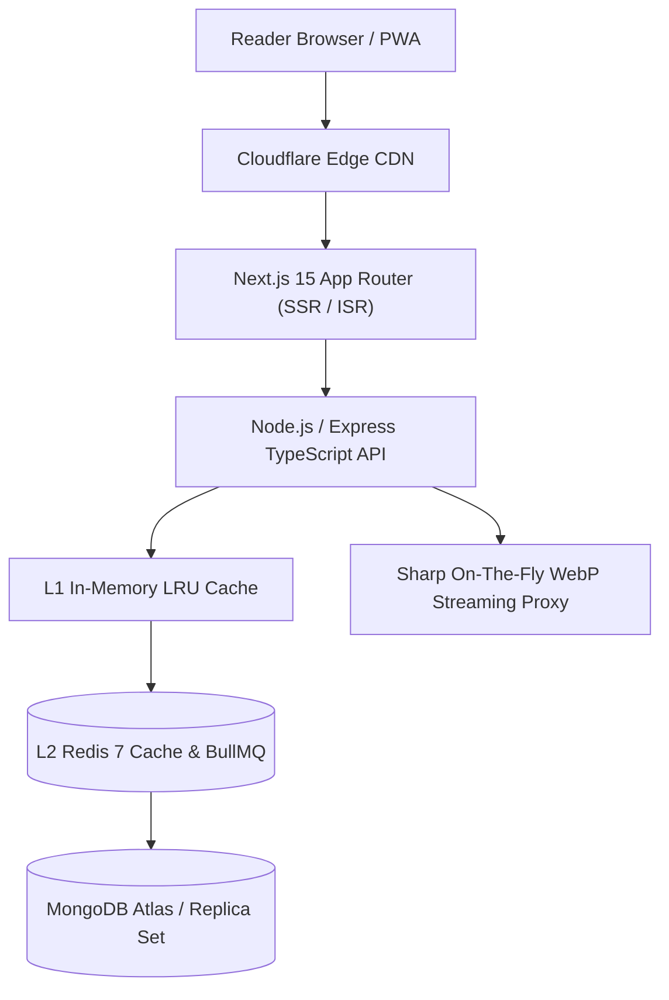

# Yasser Latrech — Full-Stack Software Engineer (TypeScript / Next.js / NestJS / Node.js)

[-10B981?style=flat-square)]()

> **FR :** Ingénieur Logiciel Full-Stack spécialisé dans la conception et le déploiement d'architectures web haute performance (**TypeScript**, **Next.js App Router SSR/ISR**, **NestJS**, **Node.js**, **PostgreSQL / Prisma**, **MongoDB**, **Redis / BullMQ**, **Docker**). Habitué à livrer des systèmes complets en production supportant des dizaines de milliers d'utilisateurs et de pages indexées avec une maîtrise stricte des coûts d'infrastructure et des Core Web Vitals.
>
> **EN:** Full-Stack Software Engineer specializing in high-concurrency web architectures, distributed background pipelines, and production SaaS platforms (**TypeScript**, **Next.js**, **NestJS**, **Node.js**, **PostgreSQL**, **MongoDB**, **Redis/BullMQ**, **Docker**, **Playwright**).

---

## 🛠️ Core Technical Stack

| Layer | Technologies |
| :--- | :--- |
| **Frontend & Mobile** | `TypeScript` · `Next.js 14/15 (App Router, SSR/ISR, RSC)` · `React.js` · `React Native` · `Tailwind CSS` · `TanStack Virtual` · `PWA / Service Workers` |
| **Backend & APIs** | `Node.js` · `NestJS` · `Express.js` · `REST APIs` · `WebSockets (Socket.io)` · `Server-Sent Events (SSE)` · `Sharp Media Streaming` · `JWT / OAuth2 / RBAC` |
| **Databases & Caching** | `PostgreSQL 16 (PostGIS)` · `Prisma ORM` · `MongoDB (Mongoose)` · `MySQL` · `Redis 7 (L1/L2 Caching & BullMQ Queues)` · `MinIO (S3 Object Storage)` |
| **DevOps, QA & Automation** | `Docker & Docker Compose` · `Turborepo (pnpm Monorepo)` · `Playwright (E2E Testing & Browser Automation)` · `Linux VPS (Nginx / PM2)` · `Cloudflare CDN` · `ClamAV` · `Git / CI-CD` |

---

## 🏗️ Featured Production Systems & Case Studies

### 1. Hospidar — Distributed Medical Logistics & Real-Time Ambulance Dispatch Monorepo (`Customer Obsession`)
- **Stack:** `Turborepo` · `NestJS` · `Next.js (x3 Web Apps)` · `React Native` · `PostgreSQL 16` · `Redis 7` · `WebSockets` · `Docker`
- **Architecture Highlights:**
  - Engineered a multi-application `Turborepo` monorepo uniting **3 Next.js web portals** (`web-patient`, `web-pro`, `admin-dashboard`), a **React Native** driver app (`ambulance-driver`), and a centralized **NestJS** API backend.
  - Built real-time geospatial ambulance tracking, dynamic pricing calculation, and asynchronous dispatch state machines powered by **PostgreSQL 16** and **Redis 7**.

---

### 2. Avids V2 — Bilingual (FR/AR) Enterprise Recruitment & Secure Document Platform (`Customer Obsession`)
- **Stack:** `Next.js` · `Node.js` · `TypeScript` · `Prisma ORM` · `PostgreSQL` · `MinIO (S3)` · `ClamAV Antivirus` · `Playwright E2E` · `Docker Compose`
- **Architecture Highlights:**
  - Architected a bilingual (`FR`/`AR` RTL) recruitment and application management platform with strict Role-Based Access Control (`RBAC`) and audit logging.
  - Designed a zero-trust document ingestion pipeline combining **MinIO S3** pre-signed storage with asynchronous **ClamAV** antivirus scanning before exposing candidate CVs to recruiters.
  - Automated critical user journey verification via **Playwright E2E** test suites inside containerized **Docker Compose** environments.

---

### 3. [Man9a.net](https://man9a.net) — High-Concurrency Digital Reading Platform (48,600+ Chapters / 61,000+ Indexed Pages)
- **Stack:** `Next.js App Router (SSR/ISR)` · `TypeScript` · `Express.js` · `MongoDB` · `Redis / BullMQ` · `Sharp WebP Proxy` · `Cloudflare Edge`
- **Architecture Highlights:**
  - Built and scaled a production content platform serving **48,600+ chapters** and **61,000+ Google-indexed URLs** on a lean Linux VPS using multi-tier **L1 RAM + L2 Redis** caching (`< 45ms` API median latency).
  - Engineered an on-the-fly **Sharp** image optimization and WebP streaming proxy (`/api/stream/image`) combined with a 60fps virtualized mobile reader (`@tanstack/react-virtual`).
  - Implemented programmatic SEO/GEO (`Schema.org JSON-LD`, dynamic multi-tier XML sitemaps, `IndexNow` instant syndication, and multilingual title deduplication).

---

### 4. Automated E-Commerce Order Confirmation & E2E Stealth Workflow Engine
- **Stack:** `Node.js` · `TypeScript` · `Baileys WhatsApp WebSockets API` · `Playwright` · `Express.js` · `MySQL / MongoDB`
- **Architecture Highlights:**
  - Built an event-driven WhatsApp order verification and customer support automation system (`Baileys API`) eliminating manual confirmation delays for COD e-commerce operations.
  - Engineered resilient headless browser workflows with `Playwright` for automated QA, visual asset generation, and multi-channel content syndication.

---

## 📫 Contact & Availability

- **Role Targets:** Full-Stack Software Engineer / Backend Node.js & TypeScript Engineer / Frontend Next.js Engineer (`CDI`, `Remote B2B`, `International Relocation`)
- **Email:** [yasser.lat2002@hotmail.com](mailto:yasser.lat2002@hotmail.com)
- **Phone / WhatsApp:** `+212 640-102787`
- **Live Production System:** [https://man9a.net](https://man9a.net)
